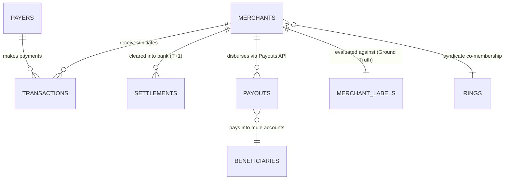

# PayU Merchant Betting Fraud Detection - Data Dictionary & Business Context

This document provides a comprehensive business and technical reference for all datasets generated in the case study. It details each table, field definitions, data types, business significance, and the underlying operational fraud indicators relevant to payment aggregators.

---

## 1. Relational Schema & Entity Architecture

### Table Overview

| Table | File Format | Record Count | Primary Key | Description |
| :--- | :--- | :--- | :--- | :--- |
| **`merchants`** | Parquet | 1,000 | `merchant_id` | Business KYB profile, onboarding metadata, declared limits |
| **`payers`** | Parquet | 100,000 | `payer_id` | Consumer master table, registration dates, home locations |
| **`transactions`** | Parquet | 5,613,310 | `txn_id` | Granular payment attempts (collections and withdrawals) |
| **`settlements`** | Parquet | 228,367 | `settlement_id` | Daily gross T+1 settlement batches credited to merchant bank |
| **`payouts`** | Parquet | 111,154 | `payout_id` | Outbound disbursements initiated via developer Payouts API |
| **`merchant_labels`** | Parquet | 1,000 | `merchant_id` | **Ground Truth only** (delayed, noisy labels; never features) |
| **`simulation_config`** | Parquet | 1 | `run_id` | Simulation parameters & random seed for auditability |

---

## 2. Detailed Table Specifications

### 2.1. `merchants` Table
Stores merchant profile information captured during onboarding, digital Know-Your-Business (KYB) underwriting, and account setup.

| Column Name | Data Type | Example Value | Description & Business Significance |
| :--- | :--- | :--- | :--- |
| **`merchant_id`** | `string` | `"M000001"` | Unique identifier assigned to the merchant business entity upon registration. |
| **`declared_category`** | `string` | `"kirana"` | Industry/MCC declared during onboarding (`kirana`, `restaurant`, `stationery`, `saas`, `sports_merch`, `gaming_recharge`, `marketplace`, `event`). Fraudulent operators deliberately declare low-scrutiny offline retail categories to pass auto-onboarding. |
| **`entity_type`** | `string` | `"sole_proprietor"` | Legal constitution of business (`sole_proprietor`, `partnership`, `pvt_ltd`). Sole proprietorships have lower documentation thresholds. |
| **`onboard_date`** | `date` | `2025-01-14` | Date when the merchant account was approved and activated to process payments. |
| **`city`** | `string` | `"Jaipur"` | Declared physical operating city of the merchant from registration/GST documents. |
| **`business_size_tier`** | `string` | `"small"` | Declared business size scale (`micro`, `small`, `medium`). Used by underwriting for velocity limits. |
| **`business_age_at_onboarding_months`** | `int64` | `14` | Operational age of business at time of registration. New entities (<6 months) carry higher baseline risk. |
| **`declared_monthly_volume`** | `float64` | `180000.00` | Estimated monthly turnover declared by merchant during onboarding (in INR). Crucial baseline for **Underwriting Arbitrage** detection when actual volume surges 5x–20x. |
| **`registered_bank_account_id`** | `string` | `"BA0000042"` | Primary current/savings account ID provided for daily settlements. Sharing this across multiple unrelated merchants indicates a syndicate ring. |
| **`registered_phone_id`** | `string` | `"PH0000115"` | Mobile number associated with business owner/authorized signatory. |
| **`registered_email_domain`** | `string` | `"brand1.in"` | Email domain used during registration (`gmail.com`, `yahoo.in`, corporate domain). Disposable/free emails on large-volume merchants indicate elevated risk. |
| **`registered_address_id`** | `string` | `"AD0000088"` | Normalized postal address identifier. Multiple distinct businesses at the exact same address indicates shared front operations or virtual offices. |
| **`onboarding_device_id`** | `string` | `"MD0000012"` | Hardware/browser fingerprint of the device used to submit the onboarding application. |
| **`onboarding_ip_block`** | `string` | `"24.120.50.0/24"` | Subnet CIDR block from which the merchant onboarded. |
| **`website_present`** | `boolean` | `True` | Whether an official merchant website or mobile app link was submitted. |
| **`website_category_match`** | `boolean` | `True` | Whether automated underwriting crawlers confirmed the website content matched declared category (or `None` if no website was provided). |

---

### 2.2. `payers` Table
Customer master table representing digital payment users across India.

| Column Name | Data Type | Example Value | Description & Business Significance |
| :--- | :--- | :--- | :--- |
| **`payer_id`** | `string` | `"P0000001"` | Unique identifier representing a unique consumer across the payment platform. |
| **`payer_name`** | `string` | `"Aarav Sharma"` | Full name of consumer as registered on banking records. |
| **`home_city`** | `string` | `"Delhi"` | Consumer's primary residential city based on banking/UPI handle metadata. |
| **`first_seen_date`** | `date` | `2024-06-12` | First date this customer transacted anywhere across the payment gateway network. |
| **`primary_instrument_id`** | `string` | `"aarav.0@okaxis"` | Primary UPI VPA or banking identifier used by the consumer. |

---

### 2.3. `transactions` Table
Granular transaction stream capturing every collection attempt, payment link payment, and refund/withdrawal.

| Column Name | Data Type | Example Value | Description & Business Significance |
| :--- | :--- | :--- | :--- |
| **`txn_id`** | `string` | `"TXN0000000001"` | Unique gateway transaction reference ID. |
| **`txn_timestamp`** | `datetime64[ns, Asia/Kolkata]` | `2025-01-06 09:14:22+05:30` | Precise timestamp of the transaction attempt in Indian Standard Time (IST). |
| **`merchant_id`** | `string` | `"M000012"` | Merchant account receiving the payment attempt. |
| **`payer_id`** | `string` | `"P0004521"` | Customer initiating the transaction. |
| **`payer_instrument_id`** | `string` | `"rohan.12@oksbi"` | Specific payment instrument used (UPI VPA, Card Token `CT...`, Bank Account `PBA...`, Wallet `WL...`). |
| **`amount`** | `float64` | `500.00` | Transaction value in INR. Betting fronts show non-Benford clustering around chip amounts (₹100, ₹200, ₹500, ₹1000, ₹2000). |
| **`payment_method`** | `category` | `"upi"` | Payment rails used: `upi`, `card`, `netbanking`, `wallet`. Betting heavily favors UPI (>90%). |
| **`txn_direction`** | `category` | `"collection"` | `collection` (consumer paying merchant) vs. `payout` (merchant paying consumer, e.g. bet winnings or refunds). |
| **`status`** | `category` | `"success"` | Transaction state: `success`, `failed`, `reversed`. |
| **`failure_reason`** | `string` | `"upi_limit"` | Reason for failure (`None`, `insufficient_funds`, `bank_timeout`, `upi_limit`, `declined`). Fraud handles face sudden spikes in `upi_limit` and `declined` due to bank risk filters. |
| **`refund_flag`** | `boolean` | `False` | Whether this transaction was subsequently refunded to the customer. |
| **`chargeback_flag`** | `boolean` | `False` | True if a dispute, card chargeback, or cybercrime police lien (I4C/1930 notice) was lodged against this payment. Key red flag for betting operations. |
| **`channel`** | `category` | `"qr"` | Interface: `qr` (UPI QR code), `payment_link` (WhatsApp/SMS link), `in_app` (mobile SDK), `checkout` (web gateway redirect). |
| **`merchant_descriptor`** | `string` | `"GENERAL STORE DEL"` | Statement text shown on customer's bank statement. Fraudsters sometimes use deceptive descriptors like `GLOBAL SERVICES 0012`. |
| **`payer_remark`** | `string` | `"dep"` | Free-text note entered by customer. Betting traffic features keywords: `"dep"`, `"bal add"`, `"topup"`, `"pts"`, `"wallet"`. |
| **`payer_device_id`** | `string` | `"PD000142"` | Smartphone/browser device fingerprint of the payer. Detects multiple distinct payers operating from identical devices (device farming). |
| **`payer_ip_block`** | `string` | `"115.240.12.0/24"` | Subnet IP block of the customer. |
| **`payer_city`** | `string` | `"Chennai"` | Customer's detected geo-location. Comparing `payer_city` against `merchants.city` produces the **Geo-Dispersion / Out-of-station Payer Ratio**. |

---

### 2.4. `settlements` Table
Records daily gross settlements credited by the payment aggregator to the merchant's bank account.

| Column Name | Data Type | Example Value | Description & Business Significance |
| :--- | :--- | :--- | :--- |
| **`settlement_id`** | `string` | `"STL000000001"` | Unique identifier for the settlement payout batch. |
| **`merchant_id`** | `string` | `"M000005"` | Merchant receiving the settlement credit. |
| **`settlement_timestamp`** | `datetime64[ns, Asia/Kolkata]` | `2025-01-07 06:14:02+05:30` | Settlement timestamp (typically cleared on T+1 morning at ~06:00 IST). |
| **`settled_amount`** | `float64` | `48520.00` | Total net amount settled into merchant's bank account for previous day's successful collections. |

---

### 2.5. `payouts` Table
Records outbound disbursements initiated by merchants using the payment aggregator's developer Payouts API (IMPS/NEFT/UPI transfer).

| Column Name | Data Type | Example Value | Description & Business Significance |
| :--- | :--- | :--- | :--- |
| **`payout_id`** | `string` | `"PO000000001"` | Unique payout transaction identifier. |
| **`merchant_id`** | `string` | `"M000018"` | Merchant account initiating the transfer. |
| **`payout_timestamp`** | `datetime64[ns, Asia/Kolkata]` | `2025-01-07 08:30:15+05:30` | Timestamp when the outbound transfer was dispatched. |
| **`payout_amount`** | `float64` | `12500.00` | Outbound transfer amount (INR). |
| **`beneficiary_id`** | `string` | `"BEN000042"` | Unique recipient identifier. |
| **`beneficiary_account_id`** | `string` | `"BA0000042"` | Destination bank account receiving the funds. Used to trace mule account networks and fund-draining rings. |

---

### 2.6. `merchant_labels` Table (Ground Truth)
**Strictly used for model training and performance evaluation.** In a live production system, these fields are *never* available at transaction time.

| Column Name | Data Type | Example Value | Description & Business Significance |
| :--- | :--- | :--- | :--- |
| **`merchant_id`** | `string` | `"M000025"` | Merchant ID. |
| **`is_fraud`** | `boolean` | `True` | **Objective ground truth**: `True` = illegal betting front; `False` = legitimate merchant. |
| **`archetype`** | `string` | `"sleeper"` | Operational fraud archetype:  • `fixed_tier`: Fixed round chip deposits, night hours, match-day spikes. • `pass_through`: High velocity mule sweep to external beneficiaries. • `sleeper`: Operates cleanly for weeks before pivoting to betting. • `none`: Legitimate merchant. |
| **`ring_id`** | `string` | `"R003"` | Identifier of the organized crime ring (e.g. `R001` - `R008`) if part of a syndicate, else `None`. |
| **`fraud_start_date`** | `date` | `2025-03-10` | The exact date unauthorized betting activity commenced. |
| **`label_known_date`** | `date` | `2025-04-22` | The date the fraud was officially uncovered by investigations/LEA notices (models must never train on labels before this date). |
| **`label_source`** | `string` | `"investigation"` | How the label was generated: `investigation`, `user_report`, `never_labeled`, `false_positive`, `none`. |
| **`observed_label`** | `int64` | `1` | Production label with realistic noise (includes 1% false positives and 30% missed frauds). |

---

### 2.7. `simulation_config` Table
Simulation metadata for provenance and auditability.

| Column Name | Data Type | Example Value | Description |
| :--- | :--- | :--- | :--- |
| **`run_id`** | `string` | `"run_seed42"` | Run identifier. |
| **`random_seed`** | `int64` | `42` | Random seed ensuring deterministic generation. |
| **`params_json`** | `string` | `{"n_merchants": 1000, ...}` | Complete JSON configuration string. |

---

## 3. Key Risk Indicators (KRIs) Mapped to Dataset Fields

| Risk Dimension | Primary Dataset Fields | What It Tells the Risk Team |
| :--- | :--- | :--- |
| **Underwriting Arbitrage** | `merchants.declared_monthly_volume` `transactions.amount` (sum) | When a micro-kirana declaring ₹1.5L/month suddenly processes ₹25L in a week, this is runaway velocity and a top red flag. |
| **Geographic Dispersion** | `merchants.city` `transactions.payer_city` | A neighborhood stationery store in Lucknow should have >85% local payers. If 80% are from Tamil Nadu, Maharashtra, and Bengal, it is a national betting front. |
| **Syndicate Rings** | `merchants.registered_bank_account_id` `merchants.onboarding_device_id` `payouts.beneficiary_account_id` | Multiple distinct merchant accounts sharing the same bank account, phone number, device, or draining funds into common beneficiary accounts. |
| **Loss-Chasing Velocity** | `transactions.payer_id` `transactions.txn_timestamp` `transactions.amount` | Bettors repeatedly depositing within 10–25 minutes at increasing amounts to chase losses. Legitimate store shoppers do not buy groceries 3 times in 20 minutes. |
| **Dispute & Acquirer Signals** | `transactions.chargeback_flag` `transactions.status` `transactions.failure_reason` | Elevated dispute rates from disgruntled bettors, LEA 1930 portal complaints, and spikes in `declined` or `upi_limit` codes. |
| **Settlement Drainage** | `settlements.settled_amount` `payouts.payout_amount` `payouts.payout_timestamp` | Pass-through accounts that immediately sweep 80–95% of settled funds to third-party bank accounts within hours of credit. |

